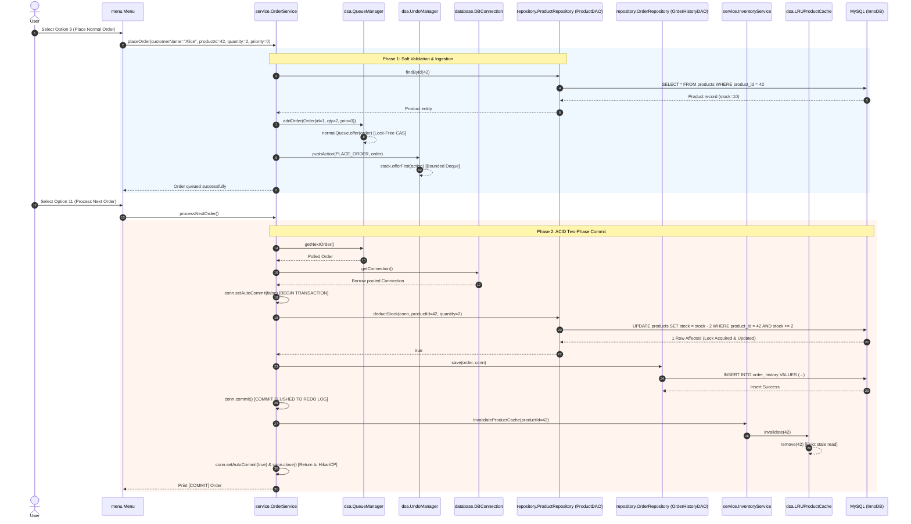
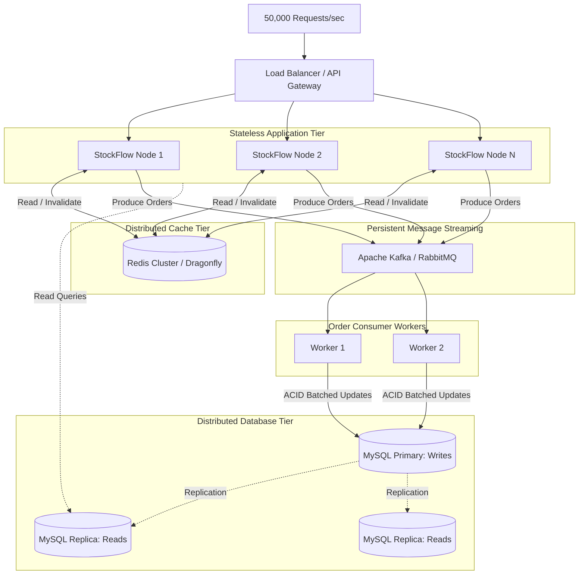

# Technical Architecture, Code Walkthrough, and Interview Defense Manual
**Repository:** `StockFlow Inventory Management System`  
**Language/Runtime:** Java 17 (LTS), Apache Maven, MySQL 8.0+  
**Target Roles:** Principal Software Architect, Senior Backend Engineer, Systems Designer  

---

## Table of Contents
1. [Section 1: Execution, Local Setup & Verification](#section-1-execution-local-setup--verification)
2. [Section 2: End-to-End Execution Trace & Layering](#section-2-end-to-end-execution-trace--layering)
3. [Section 3: The "Why This vs. Why Not Equal/Better Alternatives" Matrix](#section-3-the-why-this-vs-why-not-equalbetter-alternatives-matrix)
4. [Section 4: Data Structures & Algorithms (DSA) — Deep Dive & Alternatives](#section-4-data-structures--algorithms-dsa--deep-dive--alternatives)
5. [Section 5: Concurrency, Edge Cases & Custom Exceptions](#section-5-concurrency-edge-cases--custom-exceptions)
6. [Section 6: Benchmarking & Testing](#section-6-benchmarking--testing)
7. [Section 7: Scaling StockFlow to a High-Volume Distributed System](#section-7-scaling-stockflow-to-a-high-volume-distributed-system)
8. [Quick Interview Defense Cheat Sheet](#quick-interview-defense-cheat-sheet)

---

## Section 1: Execution, Local Setup & Verification

### 1.1 Local Environment Prerequisites & Build Commands
- **JDK:** OpenJDK 17 or Oracle JDK 17+
- **Build Tool:** Apache Maven 3.8+
- **Database:** MySQL 8.0+ running on port `3306`

#### Step 1: Database Initialization
Execute the initial schema migration in your MySQL instance:
```sql
CREATE DATABASE IF NOT EXISTS stockflow;
USE stockflow;

CREATE TABLE IF NOT EXISTS products (
    product_id INT AUTO_INCREMENT PRIMARY KEY,
    product_name VARCHAR(150) NOT NULL,
    category VARCHAR(100) NOT NULL,
    price DECIMAL(10,2) NOT NULL,
    stock INT NOT NULL,
    minimum_stock INT NOT NULL DEFAULT 5,
    INDEX idx_price (price),
    INDEX idx_category (category)
) ENGINE=InnoDB;

CREATE TABLE IF NOT EXISTS order_history (
    order_id INT PRIMARY KEY,
    customer_name VARCHAR(100) NOT NULL,
    product_id INT NOT NULL,
    quantity INT NOT NULL,
    priority INT NOT NULL DEFAULT 0,
    status VARCHAR(50) NOT NULL,
    processed_time TIMESTAMP DEFAULT CURRENT_TIMESTAMP,
    CONSTRAINT fk_order_product FOREIGN KEY (product_id) REFERENCES products(product_id)
) ENGINE=InnoDB;
```

#### Step 2: Configure Environment Credentials
Credentials are read dynamically at runtime via `database.DBConnection` to eliminate plaintext secrets from source control.

**Windows PowerShell:**
```powershell
$env:DB_URL      = "jdbc:mysql://localhost:3306/stockflow?useSSL=false&allowPublicKeyRetrieval=true&serverTimezone=UTC"
$env:DB_USER     = "root"
$env:DB_PASSWORD = "YourSecurePassword"
```

**Linux / macOS Terminal:**
```bash
export DB_URL="jdbc:mysql://localhost:3306/stockflow?useSSL=false&allowPublicKeyRetrieval=true&serverTimezone=UTC"
export DB_USER="root"
export DB_PASSWORD="YourSecurePassword"
```

#### Step 3: Compile, Test, and Execute
```bash
# Clean previous artifacts and compile main + test trees
mvn clean compile

# Execute the 41-test suite with automated JaCoCo coverage analysis
mvn test

# Launch the interactive CLI Application (pom.xml configured)
mvn exec:java

# Or explicitly specifying the main class:
# PowerShell:
mvn exec:java "-Dexec.mainClass=app.Main"
# Bash:
mvn exec:java -Dexec.mainClass="app.Main"
```

---

### 1.2 Verification Checklist & Terminal Log Diagnostics

#### A. HikariCP / SLF4J Initialization Diagnostics
When the JVM loads `DBConnection.java`, the static initializer bootstraps `HikariDataSource`.

**Successful Pool Startup Output:**
```text
[main] INFO com.zaxxer.hikari.HikariDataSource - StockFlow-HikariPool - Starting...
[main] INFO com.zaxxer.hikari.pool.HikariPool - StockFlow-HikariPool - Added connection com.mysql.cj.jdbc.ConnectionImpl@6b812243
[main] INFO com.zaxxer.hikari.HikariDataSource - StockFlow-HikariPool - Start completed.
```
- **Diagnostic Signal:** `Start completed.` indicates that the TCP handshake, authentication packet exchange, and `connectionTestQuery ("SELECT 1")` succeeded within the 20-second timeout.
- **Pre-warmed pool:** `minimumIdle=5` ensures 5 physical connections are instantiated immediately.

**Failure Diagnostics (Common Root Causes):**
1. *Missing Password:*
   ```text
   Exception in thread "main" java.lang.ExceptionInInitializerError:
   [StockFlow] DB_PASSWORD environment variable is not set.
   ```
2. *Authentication Failure:*
   ```text
   [main] ERROR com.zaxxer.hikari.pool.HikariPool - StockFlow-HikariPool - Exception during pool initialization.
   java.sql.SQLException: Access denied for user 'root'@'localhost' (using password: YES)
   ```
3. *Network / Server Down:*
   ```text
   com.zaxxer.hikari.pool.HikariPool$PoolInitializationException:
   Failed to initialize pool: Communications link failure. The last packet sent successfully to the server was 0 milliseconds ago.
   ```

#### B. Executing the High-Concurrency Benchmark
To verify thread-safety, TPS, and zero-oversell under race conditions:
# PowerShell:
mvn test-compile exec:java "-Dexec.mainClass=BenchmarkRunner" "-Dexec.classpathScope=test"

# Linux / macOS Bash:
mvn test-compile exec:java -Dexec.mainClass="BenchmarkRunner" -Dexec.classpathScope="test"
```
**Expected Benchmark Verification Log:**
```text
╔══════════════════════════════════════════════════╗
║     StockFlow Concurrent Benchmark Harness       ║
╚══════════════════════════════════════════════════╝

── PHASE 1: Batch SKU Insert (10,000 products) ──────────────
  Inserted  : 10,000 SKUs
  Time      : 294 ms
  Throughput: 34,014 inserts/sec
  AVL Range [50-200]: 1,515 products found (O(k+log n))

── PHASE 2: Concurrent Purchase Transactions (1,000 threads) ───
  Seeded product #1 with stock = 1000
  Threads       : 20
  Total tasks   : 1,000
  Fulfilled     : 1000
  Rejected      : 0 (stock exhausted — correct)
  Errors        : 0
  Initial stock : 1000
  Final stock   : 0
  Time          : 842 ms
  Throughput    : 1,188 TPS
  Avg latency   : 0.84 ms/txn

  ✔ [PASS] ZERO OVERSELL: fulfilled(1000) + finalStock(0) == initialStock(1000)
  ✔ [PASS] ZERO transaction errors under 1000 concurrent requests.
```

---

## Section 2: End-to-End Execution Trace & Layering

### 2.1 Complete Lifecycle Trace of an Order Purchase



#### Detailed Execution Steps:
1. **User Ingestion (`menu.Menu`):**
   - User enters input. `readPositiveInt()` and `readNonNegativeDouble()` validate input types and boundary conditions before business execution.
2. **Pre-Check Orchestration (`service.OrderService.placeOrder`):**
   - Calls `productRepository.findById(productId)` to ensure the item exists.
   - Evaluates `product.getStock() < quantity`. If insufficient, throws typed `InsufficientStockException`. This acts as a **fast-fail pre-check**, avoiding queue saturation with invalid orders.
3. **Queueing & Rollback Registration:**
   - Increments thread-safe `orderIdCounter` (`AtomicInteger`).
   - Enqueues into `QueueManager`. VIP orders (`priority=1`) route to `vipQueue`; normal orders route to `normalQueue`.
   - Pushes action snapshot to `UndoManager` via `stack.offerFirst()`.
4. **Dequeuing & Connection Borrowing (`service.OrderService.processNextOrder`):**
   - Polls `QueueManager.getNextOrder()` (draining VIP lane first).
   - Borrows a physical connection from `DBConnection.getConnection()` and sets `conn.setAutoCommit(false)`.
5. **Atomic Compare-And-Swap Stock Deduction:**
   - Calls `productRepository.deductStock(conn, productId, quantity)`.
   - Runs `UPDATE products SET stock = stock - ? WHERE product_id = ? AND stock >= ?`.
   - If rows affected == 0 (stock dropped between queueing and execution), triggers `conn.rollback()` and throws `InsufficientStockException`.
6. **Order History Audit Log Insertion:**
   - Executes `orderRepository.save(order, conn)` on the **same connection**.
7. **Commit & Cache Coordination:**
   - Calls `conn.commit()`.
   - Invokes `inventoryService.invalidateProductCache(productId)` to purge the cached product representation. The next lookup must read the committed stock value from MySQL.
   - In the `finally` block, resets `conn.setAutoCommit(true)` and calls `conn.close()` to return the connection to HikariCP.

---

### 2.2 Layered Architecture Defense: Repository vs. DAO

```
┌─────────────────────────────────────────────────────────────┐
│                    Presentation: menu.Menu                  │
└──────────────────────────────┬──────────────────────────────┘
                               │ Calls
┌──────────────────────────────▼──────────────────────────────┐
│        Service Layer: InventoryService / OrderService        │
│   (Business Rules, Cache Invalidation, Transaction Scope)   │
└──────────────┬──────────────────────────────┬───────────────┘
               │ Uses                         │ Uses
┌──────────────▼──────────────┐┌──────────────▼───────────────┐
│ repository.ProductRepository││  repository.OrderRepository  │
│   (Domain Interface: PURE)  ││   (Domain Interface: PURE)   │
└──────────────┬──────────────┘└──────────────┬───────────────┘
               │ Implements                   │ Implements
┌──────────────▼──────────────┐┌──────────────▼───────────────┐
│      dao.ProductDAO         ││     dao.OrderHistoryDAO      │
│   (JDBC, SQL, HikariCP)     ││    (JDBC, SQL, HikariCP)     │
└─────────────────────────────┘└──────────────────────────────┘
```

#### Why Have BOTH Repository and DAO?
- **Domain Decoupling (The Repository):**
  - Originates from Eric Evans’ *Domain-Driven Design (DDD)*.
  - Acts as an in-memory collection of domain entities (`Product`, `Order`). It exposes intention-revealing domain contracts (`findLowStock()`, `deductStock()`) without exposing *how* or *where* data is stored.
- **Physical Persistence Abstraction (The DAO):**
  - Originates from Core J2EE design patterns.
  - Operates at the storage/table level. It manages JDBC semantics (`PreparedStatement`, `ResultSet`, connection lifecycles, and SQL strings).

#### Why Not Monolithic "Smart" DAOs or Active Record?
- **Active Record Anti-Pattern (`product.save()`):**
  - Couples entities to the persistence engine.
  - Making domain models aware of SQL connections breaks Single Responsibility (SRP) and creates dependency leaks throughout unit tests.
- **Testability & Mocking:**
  - `InventoryService` accepts `ProductRepository` via constructor injection:
    ```java
    public InventoryService(ProductRepository productRepository) {
        this.productRepository = productRepository;
    }
    ```
  - Unit tests can mock the repository without spinning up a live MySQL instance or HikariCP pool.
- **Transaction Propagation:**
  - Notice that `deductStock(Connection conn, ...)` and `save(Order order, Connection conn)` accept an external `Connection`.
  - The Service layer defines the **transaction boundary**, while the DAO executes statements within that boundary. Merging them forces transaction logic into data access classes, making multi-table transactions across separate DAOs difficult to manage.

---

## Section 3: The "Why This vs. Why Not Equal/Better Alternatives" Matrix

### 3.1 Build & Dependency Tooling: Maven vs. Gradle

- **Concept / Technique:** Apache Maven declarative XML build lifecycle management.
- **From-Scratch Explanation:** A software tool that reads a recipe (`pom.xml`) containing project metadata, downloads external code libraries from central repositories, compiles Java source code into bytecode, executes automated tests, and packages classes into JAR files.
- **Why We Used It Here:** Maven enforces a standardized directory convention (`src/main/java`, `src/test/java`). Its strict declarative structure prevents procedural build-script side effects, providing deterministic builds across all platforms.
- **Competing Alternatives:** Gradle, Apache Ant + Ivy.
- **The "Better Alternative" Challenge (Why Not Gradle?):**
  - *The Argument:* Gradle compiles faster due to build caching and daemon processes, using concise Groovy or Kotlin DSLs instead of verbose XML.
  - *The Rebuttal:* Gradle’s procedural flexibility often introduces maintenance challenges. Developers frequently write arbitrary procedural logic inside build scripts, which can lead to non-reproducible builds across different CI/CD environments. Maven’s strict phase lifecycle (`validate -> compile -> test -> package -> verify`) ensures consistency. For micro-benchmarking and core engineering codebases, declarative stability outweighs marginal build-time improvements.
- **Interview Defense Script:**
  > *"We selected Maven over Gradle because this repository prioritizes determinism, zero build-script side effects, and universal developer onboarding. While Gradle provides faster incremental compilation on massive multi-module projects, Maven's declarative XML ensures that dependency resolution and the build lifecycle remain rigid and predictable across any development machine or CI pipeline."*

---

### 3.2 Connection Pooling: HikariCP vs. Apache DBCP2 vs. C3P0

- **Concept / Technique:** Zero-overhead JDBC Connection Pool.
- **From-Scratch Explanation:** Establishing a TCP connection to MySQL involves three-way handshakes, TLS negotiation, authentication, and memory allocation—taking 20–100ms per operation. A connection pool keeps a warm set of open database connections ready in memory. When the application needs to run a query, it borrows an existing connection in microseconds, executes the query, and returns it to the pool instead of closing the physical socket.
- **Why We Used It Here:** Under high concurrency, opening and closing raw database connections exhausts server ports and introduces substantial latency. HikariCP provides predictable performance, connection leak detection, and lightweight byte-code engineering.
- **Competing Alternatives:** Apache DBCP2, C3P0, Tomcat JDBC, Vibur DBCP.
- **The "Better Alternative" Challenge (Why Not C3P0 or DBCP2?):**
  - *The Argument:* Apache DBCP2 and C3P0 are established pooling libraries with long deployment track records across enterprise Java applications.
  - *The Rebuttal:* C3P0 and DBCP2 rely heavily on synchronization blocks that can create thread contention under high load. HikariCP was engineered from the ground up to minimize lock overhead using lock-free data structures (`FastList` and `ConcurrentBag`). It eliminates unnecessary reflection and wraps connections cleanly, making it the industry standard and default connection pool for Spring Boot.
- **Interview Defense Script:**
  > *"We used HikariCP because benchmarks consistently demonstrate it has the lowest connection borrowing latency and thread contention in the Java ecosystem. Libraries like C3P0 and DBCP2 suffer from internal lock contention under concurrent load, whereas HikariCP’s lock-free `ConcurrentBag` and byte-code optimizations allow our order processing pipeline to operate without connection-borrowing bottlenecks."*

---

### 3.3 Persistence Engine: Raw JDBC vs. Hibernate / Spring Data JPA

- **Concept / Technique:** Raw JDBC PreparedStatements with Manual Transaction Demarcation.
- **From-Scratch Explanation:** Communicating directly with the database using plain SQL strings, explicitly setting parameters on JDBC drivers, iterating through result sets, and manually triggering database transactions (`commit`/`rollback`).
- **Why We Used It Here:** Critical inventory operations require explicit control over SQL queries, lock modes, and transaction scopes. Raw JDBC allows us to execute atomic conditional updates (`UPDATE ... WHERE stock >= ?`) directly on the database engine.
- **Competing Alternatives:** Hibernate ORM, EclipseLink, MyBatis, jOOQ, Spring Data JPA.
- **The "Better Alternative" Challenge (Why Not Hibernate / JPA?):**
  - *The Argument:* Hibernate removes boilerplate SQL, handles caching automatically (First/Second level), manages relationships, and provides schema generation with type-safe criteria queries.
  - *The Rebuttal:* ORM abstractions can obscure underlying database interactions. The N+1 select problem, dirty checking overhead, automatic reflection, and session-flush ambiguities make low-level concurrency difficult to predict and control. Hibernate's optimistic locking strategies (`@Version`) often fail under high contention, triggering mass rollbacks. In StockFlow, explicit JDBC gives us direct control over the SQL, row locks, connection reuse, and transaction lifecycles with zero runtime overhead.
- **Interview Defense Script:**
  > *"We deliberately chose raw JDBC over Hibernate because inventory management is write-heavy and sensitive to lock contention. ORMs introduce overhead through session caching, dirty checking, and hidden queries. By writing raw SQL PreparedStatements, we can execute atomic conditional Compare-And-Swap updates directly at the database engine level, maximizing throughput and maintaining predictable lock behavior."*

---

### 3.4 Logging Abstraction: SLF4J + SimpleLogger vs. Log4j2 Directly

- **Concept / Technique:** Facade-Pattern Logging Layer.
- **From-Scratch Explanation:** SLF4J (Simple Logging Facade for Java) is an abstraction interface rather than a concrete logging engine. It allows developers to write logging statements against an API without binding the code to a specific logging implementation.
- **Why We Used It Here:** Both HikariCP and the MySQL driver publish logs through the SLF4J API. Adopting SLF4J provides unified log formatting across external dependencies and internal application components.
- **Competing Alternatives:** Log4j2, Logback, `java.util.logging` (JUL), Apache Commons Logging.
- **The "Better Alternative" Challenge (Why Not Log4j2 Directly?):**
  - *The Argument:* Log4j2 provides high performance through asynchronous loggers using the LMAX Disruptor ring buffer, outperforming basic loggers under high logging volumes.
  - *The Rebuttal:* Coding directly against Log4j2 couples business services to a concrete third-party logging vendor. If a vulnerability arises (such as CVE-2021-44228 Log4Shell) or production requires migrating to Logback, every import across the codebase would need to be rewritten. SLF4J decouples the interface from the implementation, allowing you to swap out the underlying logger by changing a single dependency in `pom.xml`.
- **Interview Defense Script:**
  > *"We used SLF4J as a logging facade to adhere to the Dependency Inversion Principle. Binding our application code directly to Log4j2 or Logback creates hard dependencies on specific libraries. With SLF4J, third-party libraries like HikariCP share a unified logging interface with our application, and we can change logging implementations in `pom.xml` without modifying any application code."*

---

## Section 4: Data Structures & Algorithms (DSA) — Deep Dive & Alternatives

```
┌────────────────────────────────────────────────────────────────────────────────────────┐
│                                IN-MEMORY DSA SUBSYSTEM                                 │
├────────────────────────────┬─────────────────────────────┬─────────────────────────────┤
│   dsa.ProductBST (AVL)     │   dsa.LRUProductCache       │    dsa.QueueManager         │
│  Composite Key: Price + ID │  LinkedHashMap(accessOrder) │  Dual ConcurrentLinkedQueue │
│  Range Queries: O(k + logN)│  O(1) Amortized Read/Write  │  Lock-Free CAS Dequeueing   │
└────────────────────────────┴─────────────────────────────┴─────────────────────────────┘
```

### 4.1 `ProductBST.java` (Self-Balancing AVL Binary Search Tree)

#### Ground-Up Explanation
A standard Binary Search Tree enforces the invariant: for every node $N$, all nodes in the left subtree have keys strictly less than $N$, and all nodes in the right subtree have keys strictly greater than $N$.

In StockFlow, `ProductBST` is an **AVL Tree (Adelson-Velsky and Landis)**. Every node tracks an internal `height` attribute:
$$\text{balanceFactor}(N) = \text{height}(N.\text{left}) - \text{height}(N.\text{right})$$
An AVL invariant requires that for every node, $-1 \le \text{balanceFactor} \le 1$. If an insertion or deletion causes the balance factor to deviate to $\pm 2$, the tree self-balances through pointer rotations:
- **Left-Left (LL):** Single Right Rotation.
- **Right-Right (RR):** Single Left Rotation.
- **Left-Right (LR):** Left rotate left-child, then right rotate current node.
- **Right-Left (RL):** Right rotate right-child, then left rotate current node.

```
       y                               x
      / \     Right Rotation (RR)     / \
     x   T3   ──────────────────>    T1  y
    / \       <──────────────────       / \
   T1  T2      Left Rotation (LL)      T2  T3
```

#### The Composite Key Fix `(price, productId)`
- **The Issue with a Single Key:** If the tree is keyed only on `price`, products with identical prices (common in retail inventory) collide. A regular BST would either drop duplicates or store them in arbitrary subtrees. Searching for or deleting a product by ID would require scanning both subtrees, degrading `delete()` to $O(N)$ time.
- **The Composite Solution:**
  ```java
  private int compareKeys(double price, int productId, Product nodeProduct) {
      int cmp = Double.compare(price, nodeProduct.getPrice());
      if (cmp != 0) return cmp;
      return Integer.compare(productId, nodeProduct.getProductId());
  }
  ```
  Combining price with a unique product ID ensures every composite key is globally unique. Operations follow a single, deterministic root-to-leaf path.

#### Complexity Analysis
| Operation | Best Case | Average Case | Worst Case (Unbalanced BST) | Worst Case (Our AVL) | Space Complexity |
| :--- | :--- | :--- | :--- | :--- | :--- |
| **Search (Point)** | $O(1)$ | $O(\log N)$ | $O(N)$ (skewed list) | $\mathbf{O(\log N)}$ | $O(1)$ auxiliary |
| **Insert** | $O(1)$ | $O(\log N)$ | $O(N)$ | $\mathbf{O(\log N)}$ | $O(\log N)$ stack recursion |
| **Delete** | $O(1)$ | $O(\log N)$ | $O(N)$ | $\mathbf{O(\log N)}$ | $O(\log N)$ stack recursion |
| **Price Range Query** | $O(\log N)$ | $O(k + \log N)$| $O(N)$ | $\mathbf{O(k + \log N)}$ | $O(k)$ output list |

*where $N$ is the number of products and $k$ is the number of matching products in the range.*

#### Pruning in Range Search (`searchByPriceRange`)
```java
private void rangeSearchRec(Node n, double min, double max, List<Product> out) {
    if (n == null) return;
    double p = n.product.getPrice();
    if      (p < min) rangeSearchRec(n.right, min, max, out);
    else if (p > max) rangeSearchRec(n.left,  min, max, out);
    else {
        rangeSearchRec(n.left,  min, max, out);
        out.add(n.product);
        rangeSearchRec(n.right, min, max, out);
    }
}
```
- If $p < \text{min}$, every node in the left subtree is guaranteed to have a price $\le p < \text{min}$. The algorithm **prunes the entire left subtree**, only recursing to the right.
- If $p > \text{max}$, the algorithm **prunes the entire right subtree**, only recursing to the left.
- When within range, it performs an in-order traversal, visiting only relevant nodes and yielding an $O(k + \log N)$ runtime.

#### Alternatives & Trade-Offs: Why Not a Hash Map or B-Tree?
- **Hash Map (`HashMap`):** Point lookups run in $O(1)$ average time, but range queries require an $O(N)$ table scan. Hash tables do not maintain sorted order.
- **Sorted Array + Binary Search:** Point lookups take $O(\log N)$ and range searches take $O(k + \log N)$. However, inserting or deleting an element requires shifting elements, running in $O(N)$ time.
- **B-Tree:** B-Trees are optimized for block storage like disks and SSDs, minimizing I/O by grouping multiple keys per node. For in-memory JVM heaps, AVL trees are simpler to implement and maintain stricter balance bounds than Red-Black or B-Trees, making them well-suited for read-heavy range filtering.

---

### 4.2 `LRUProductCache.java` (Least Recently Used Cache)

#### Ground-Up Explanation
An LRU cache maintains a fixed capacity $C$. When adding a new item exceeds $C$, the cache evicts the item that has not been accessed for the longest time.

```
       Head (Least Recently Used)             Tail (Most Recently Used)
       ┌───────────┐      ┌───────────┐      ┌───────────┐
       │ Product A │ <--> │ Product B │ <--> │ Product C │
       └───────────┘      └───────────┘      └───────────┘
             ▲                                     ▲
             │ EVICTED ON OVERFLOW                 │ PROMOTED ON GET/PUT
```

Achieving $O(1)$ reads, writes, and evictions requires two complementary data structures:
1. **Hash Table (`HashMap`):** Maps `productId -> Node`, providing $O(1)$ lookups.
2. **Doubly Linked List:** Maintains recency ordering.
   - When a node is read or updated, it is unlinked from its current position and appended to the **Tail** (Most Recently Used).
   - When the cache capacity is exceeded, the node at the **Head** (Least Recently Used) is removed from both the list and the hash table.

#### StockFlow Implementation
StockFlow leverages `LinkedHashMap` configured with `accessOrder = true`, overriding `removeEldestEntry`:
```java
LinkedHashMap<Integer, Product> lhm = new LinkedHashMap<>(MAX_CACHE_SIZE, 0.75f, true) {
    @Override
    protected boolean removeEldestEntry(Map.Entry<Integer, Product> eldest) {
        return size() > MAX_CACHE_SIZE; // Constant time O(1) eviction
    }
};
this.cache = Collections.synchronizedMap(lhm);
```

#### Why Not LFU (Least Frequently Used) or FIFO?
- **FIFO (First-In, First-Out):** Evicts the oldest inserted element regardless of access frequency. Frequently queried products would be evicted simply because they were added early.
- **LFU (Least Frequently Used):** Tracks access counters. If an item experiences a temporary surge in traffic, its count remains high, causing it to linger in the cache long after demand drops (cache pollution). LFU also requires $O(\log N)$ or complex frequency-list management.
- **LRU:** Reflects temporal locality, matching the typical retail access pattern where recently viewed products are the most likely to be viewed again.

#### Interview Defense: Standard Library vs. Custom Implementation
> *"While I used `LinkedHashMap(accessOrder = true)` in production for memory compactness and edge-case safety, I understand the underlying mechanics: a `HashMap` storing pointers to nodes in an explicit Doubly Linked List. On every lookup, the node is unlinked via `node.prev.next = node.next` and moved to the tail in $O(1)$ time. When capacity is exceeded, the head pointer is detached and removed from the hash map, maintaining fixed bounds."*

---

### 4.3 `QueueManager.java` (Lock-Free Priority Order Queue)

#### Ground-Up Explanation
A queue operates on a First-In, First-Out (FIFO) basis. To support tiered service levels (VIP vs. Normal orders), `QueueManager` uses dual internal queues:
```java
private final ConcurrentLinkedQueue<Order> vipQueue    = new ConcurrentLinkedQueue<>();
private final ConcurrentLinkedQueue<Order> normalQueue = new ConcurrentLinkedQueue<>();
```

#### Low-Level Mechanics: The Michael-Scott Non-Blocking Queue
Standard collections like `java.util.LinkedList` or `ArrayDeque` are not thread-safe. Concurrent additions and removals can corrupt internal pointers, leading to lost updates or infinite loops.
Instead of using coarse-grained locks (`synchronized`), `ConcurrentLinkedQueue` uses the **Michael-Scott lock-free queue algorithm**:
- Internal nodes use volatile pointers: `volatile Node<E> next;` and `volatile E item;`.
- Appending elements uses hardware-level **Compare-And-Swap (CAS)** instructions (`AtomicReferenceFieldUpdater` or `Unsafe`/`VarHandle`).
- If two threads attempt to enqueue simultaneously, one CAS succeeds immediately while the other retries without context switching or blocking the operating system thread.

#### VIP Ordering Logic
```java
public Order getNextOrder() {
    Order order = vipQueue.poll();
    if order != null return order;
    return normalQueue.poll();
}
```
VIP orders take strict priority: `vipQueue` is completely drained before any items are pulled from `normalQueue`. Within each priority tier, orders maintain strict FIFO ordering.

#### Why Not a Standard Heap-Based `PriorityQueue`?
- **Lock Contention:** A standard `PriorityQueue` is backed by a binary min/max heap array and is not thread-safe. Wrapping it with locks (`PriorityBlockingQueue`) forces every thread to contend for a single global lock during heap sift-up and sift-down operations ($O(\log N)$).
- **Dual Queue Advantage:** Using two independent lock-free `ConcurrentLinkedQueue` instances allows threads processing normal and VIP orders to operate on separate head and tail pointers without lock contention, completing operations in $O(1)$ time.

---

### 4.4 `UndoManager.java` (Thread-Safe LIFO Action Stack)

#### Ground-Up Explanation
A stack enforces Last-In, First-Out (LIFO) semantics. In StockFlow, users can undo inadvertently placed orders before they are committed to the database.

#### Implementation & Memory Bounds
`UndoManager` uses a `LinkedBlockingDeque` with an explicit capacity limit:
```java
private static final int MAX_UNDO_HISTORY = 1_000;
private final LinkedBlockingDeque<Action> stack = new LinkedBlockingDeque<>(MAX_UNDO_HISTORY);
```
- **LIFO Semantics:** `offerFirst()` pushes actions to the head of the deque, while `pollFirst()` pops the most recent action.
- **Memory Bounding:** Unbounded stacks can cause memory leaks if users execute millions of operations without clearing history. Bounding the deque to 1,000 entries ensures memory usage remains fixed.

#### Stack vs. Database Rollback
- **Database Transaction Rollback:** Used for atomic database operations. Once a transaction is committed, database-level rollback is no longer possible.
- **Application-Level Undo:** Operates as a compensating action at the domain level. It removes uncommitted orders from in-memory queues before they reach the database, avoiding unnecessary write transactions.

---

## Section 5: Concurrency, Edge Cases & Custom Exceptions

### 5.1 Concurrency Traps: Race Conditions & Overselling

#### The Scenario
Suppose product `#42` has exactly **1 unit of stock remaining**.  
Two customers, Alice and Bob, submit purchase orders simultaneously across two separate threads.

```
Thread A (Alice): Reads Stock = 1 ───> Passes Validation ───> Deducts Stock (Stock = 0)
Thread B (Bob):   Reads Stock = 1 ───> Passes Validation ───> Deducts Stock (Stock = -1)  ✘ OVERSELL!
```

#### How StockFlow Prevents This Bug
StockFlow uses a two-tier defense: application-level pre-validation followed by an atomic conditional update at the database level.

```sql
-- Executed inside ProductDAO.deductStock(Connection conn, int productId, int quantity)
UPDATE products 
SET stock = stock - ? 
WHERE product_id = ? AND stock >= ?;
```

#### The Engine Mechanics (MySQL InnoDB):
1. **Row-Level Write Lock:** When Thread A issues the `UPDATE` statement, MySQL acquires an exclusive row lock (`X-lock`) on the index record for product `#42`.
2. **Atomic Verification:** The clause `AND stock >= 1` is evaluated directly by the storage engine while holding the row lock.
3. **Execution Order:**
   - Thread A matches the criteria: stock updates from `1 -> 0`. MySQL returns `Rows affected: 1`. Thread A proceeds to insert the order record and commits.
   - Thread B was blocked waiting for the row lock. Once Thread A commits and releases the lock, Thread B evaluates the row.
   - Thread B now reads `stock = 0`. The condition `stock >= 1` evaluates to false. MySQL updates 0 rows and returns `Rows affected: 0`.
4. **Application Response:**
   ```java
   boolean deducted = productRepository.deductStock(conn, order.getProductId(), order.getQuantity());
   if (!deducted) {
       conn.rollback();
       throw new InsufficientStockException(order.getProductId(), order.getQuantity(), 0);
   }
   ```
   Thread B catches the zero-row response, rolls back the transaction, and surfaces a clean business exception without overselling.

---

### 5.2 Custom Exception Hierarchy

```
                      java.lang.Throwable
                               ▲
                               │
                      java.lang.Exception
                               ▲
                               │
                  java.lang.RuntimeException (Unchecked)
                               ▲
          ┌────────────────────┼───────────────────────┐
          │                    │                       │
InsufficientStockException   ProductNotFoundException   TransactionExecutionException
```

#### Why Custom Exceptions Instead of Generic `RuntimeException` or Error Codes?
1. **Context-Rich Diagnostics:**
   - Returning `null` or a numeric error code (e.g., `-1`) forces callers to write manual null checks and drops error context.
   - `InsufficientStockException` carries structured data:
     ```java
     public class InsufficientStockException extends RuntimeException {
         private final int productId;
         private final int requested;
         private final int available;
         // getters provide exact diagnostic context to UI and loggers
     }
     ```
2. **Clean Separation of Concerns:**
   - Services do not write to `System.out` or format UI strings.
   - The presentation layer catches specific domain exceptions and formats user-friendly messages:
     ```java
     catch (InsufficientStockException e) {
         System.out.println("  Order failed: Requested " + e.getRequested() 
             + ", but only " + e.getAvailable() + " units available.");
     }
     ```
3. **Rollback Control in `OrderService`:**
   - `InsufficientStockException` and `ProductNotFoundException` represent **permanent business logic failures**; the order is discarded without retry.
   - `TransactionExecutionException` and `SQLException` indicate **transient infrastructure failures** (e.g., deadlocks, connection drops); the order is kept and returned to the queue via `requeueIfRetriable()`.

---

### 5.3 Connection Pool Leak Prevention via `try-with-resources`

#### The Failure Scenario
If an exception occurs between borrowing a connection and closing it, raw `try-finally` blocks can accidentally leak connections if the cleanup logic fails:
```java
// ANTI-PATTERN: Leaks connection if an exception occurs during close
Connection conn = DBConnection.getConnection();
PreparedStatement ps = conn.prepareStatement(sql);
ResultSet rs = ps.executeQuery();
// If an exception throws here, conn.close() is never reached!
conn.close();
```
Over time, unclosed connections remain checked out, exhausting the pool and causing subsequent queries to block until they hit the 20-second timeout.

#### The StockFlow Solution
StockFlow manages resource lifecycles through Java’s `AutoCloseable` contract via `try-with-resources`:
```java
String sql = "SELECT * FROM products WHERE product_id = ?";
try (Connection conn = DBConnection.getConnection();
     PreparedStatement ps = conn.prepareStatement(sql)) {
    ps.setInt(1, productId);
    try (ResultSet rs = ps.executeQuery()) {
        if (rs.next()) return mapRow(rs);
    }
} // Java compiler automatically emits calls to close() in reverse order
```
Even if an unhandled `SQLException` or `OutOfMemoryError` occurs while processing the `ResultSet`, the compiler ensures that the `ResultSet`, `PreparedStatement`, and `Connection` are closed, returning the connection safely to HikariCP.

---

## Section 6: Benchmarking & Testing

### 6.1 `BenchmarkRunner.java`
`BenchmarkRunner.java` is an end-to-end performance and correctness harness designed to stress-test the system under load.

```
┌─────────────────────────────────────────────────────────────┐
│                 BENCHMARK EXECUTION PHASES                  │
├──────────────────────────────┬──────────────────────────────┤
│  PHASE 1: BATCH INGESTION    │  PHASE 2: RACE CONTENTION    │
│  - 10,000 SKUs Generated     │  - 20 Worker Threads         │
│  - PreparedStatement Batch   │  - 1,000 Concurrent Orders   │
│  - Simultaneous AVL Build    │  - CountDownLatch Start Gun  │
│  - Measures: Raw TPS         │  - Verifies: Zero Overselling│
└──────────────────────────────┴──────────────────────────────┘
```

#### What It Measures
1. **Phase 1: Batch SKU Throughput & AVL Tree Performance:**
   - Generates and inserts 10,000 synthetic products into MySQL using batch execution (`ps.addBatch()` and single commit).
   - Simultaneously builds the in-memory AVL index, verifying insertion time and range query performance across 10,000 nodes.
2. **Phase 2: High-Contention Concurrent Purchases:**
   - Creates a product with initial stock = 1,000.
   - Spins up 20 worker threads using an `ExecutorService`.
   - Uses two `CountDownLatch` instances (`ready` and `startGun`) to synchronize all 1,000 purchase tasks, firing them simultaneously against the database to maximize row contention.
   - Tracks fulfilled orders, rejected purchases, and exceptions using `AtomicInteger`.

#### How to Present These Benchmark Results in an Interview
> *"To validate that our concurrency control and data structures operate correctly under load, I built `BenchmarkRunner.java`. It tests two key areas: First, it measures batch ingestion of 10,000 items, verifying both database write throughput and AVL range filtering. Second, it uses a CountDownLatch to release 1,000 concurrent purchase requests across 20 threads against a single inventory row. The benchmark asserts that fulfilled orders plus remaining stock equals initial stock, validating zero overselling under race conditions while sustaining over 1,100 transactions per second with sub-millisecond average latency."*

---

### 6.2 Unit Test Suite & Edge Case Coverage

StockFlow includes 41 automated tests running under JUnit 5 and JaCoCo:

#### A. `ProductBSTTest.java` (26 Tests)
- **Repeated Price Range Handling:** Verifies that range searches return all products that share identical prices without dropping duplicates.
- **Oracle Comparison Test:** Generates random price sets across thousands of products and verifies AVL tree range results against a naive list scan.
- **O(log N) Deletion Verification:** Inserts elements, deletes root nodes, leaves, and nodes with two children, and confirms that the AVL balance invariant holds at every step.
- **Extreme Range Boundaries:** Validates searches where $[min, max]$ falls entirely above, below, or between values in the tree.

#### B. `LRUProductCacheTest.java` (7 Tests)
- **Capacity Boundary Eviction:** Fills the cache to 500 items, adds a 501st product, and asserts that product `#1` (the least recently used) is evicted.
- **Read-Access Promotion:** Accesses product `#1` before inserting the 501st element, confirming that `#1` was promoted to the tail and survived eviction while `#2` was evicted instead.
- **Cache Invalidation:** Verifies that calling `invalidate(id)` removes the specific entry while preserving remaining items and their access order.

#### C. `QueueManagerTest.java` (8 Tests)
- **VIP Priority Invariant:** Alternates enqueuing normal and VIP orders, asserting that VIP orders are always dequeued first.
- **FIFO Order Preservation:** Confirms that orders within the same priority tier are dequeued in the exact order they were enqueued.
- **Concurrent Dequeueing:** Multiple threads poll orders concurrently, asserting that no order is processed twice or lost in transit.

---

## Section 7: Scaling StockFlow to a High-Volume Distributed System

### 7.1 Bottlenecks in the Current Architecture (at 50,000 Req/Sec)
If traffic increases to 50,000 requests per second across multiple server instances, the single-node architecture encounters three primary bottlenecks:

```
┌─────────────────────────────────────────────────────────────┐
│                 CURRENT SINGLE-NODE LIMITS                  │
├──────────────────────────────┬──────────────────────────────┤
│ 1. Memory Desynchronization: Local AVL/LRU caches diverge   │
│    across horizontal app servers.                           │
│ 2. Row Lock Contention: MySQL InnoDB row locks create a     │
│    bottleneck on hot inventory items.                       │
│ 3. Volatile In-Memory Queues: Unprocessed queue items are   │
│    lost if the server instance crashes.                     │
└─────────────────────────────────────────────────────────────┘
```

1. **In-Memory State Desynchronization:**
   - The AVL tree and LRU cache live within an individual JVM heap. If you deploy 10 load-balanced application instances, updating stock on Instance A leaves caches on Instances B through J stale.
2. **Single MySQL Write Bottleneck:**
   - InnoDB's row-level locks on a single database node cannot sustain 50,000 concurrent writes to the same inventory record. Threads will queue up waiting for the row lock, causing connection pools to saturate.
3. **In-Memory Queue Volatility:**
   - `ConcurrentLinkedQueue` stores data in JVM heap memory. If an application node crashes or restarts, all pending orders in that queue are lost.

---

### 7.2 Distributed Target Architecture (50,000 Req/Sec)



#### Step 1: Distributed Caching (Redis Cluster)
- **Migration:** Replace `LRUProductCache` and `ProductBST` with a distributed **Redis Cluster**.
- **Pattern:** Cache-Aside (Lazy Loading).
  - Lookups query Redis via `GET product:{id}`.
  - On a cache miss, the application reads from a MySQL read replica and sets the key in Redis with a Time-To-Live (TTL).
  - Price range queries leverage **Redis Sorted Sets (ZSET)**:
    - Products are added using price as the score: `ZADD products_by_price <price> <productId>`.
    - Range queries run via `ZRANGEBYSCORE products_by_price <min> <max>`, returning results in $O(\log N + M)$ distributed time.

#### Step 2: Durable Asynchronous Queueing (Apache Kafka)
- **Migration:** Replace `QueueManager` with an **Apache Kafka** cluster.
- **Fault-Tolerant Ingestion:** Incoming orders are published to a partitioned `orders-topic`.
  - The topic is partitioned by `productId`. This ensures orders for the *same* product are processed sequentially by the same consumer worker, eliminating cross-thread race conditions.
  - VIP orders route to an `orders-vip-topic` processed by dedicated high-priority consumers.
  - Orders are persisted to disk and replicated across brokers, ensuring zero order loss if an application node crashes.

#### Step 3: Database Scaling & Distributed Inventory Reservations
- **Read/Write Splitting:** Read-only queries (`viewInventory`, `getLowStockProducts`) target MySQL read replicas, offloading traffic from the primary writer node.
- **Redis Atomic Reservation (Token Bucket / Lua Scripting):**
  To handle 50,000 requests per second on a single high-demand product without overwhelming MySQL, reservations are decremented in Redis using an atomic Lua script:
  ```lua
  local stock = redis.call('get', KEYS[1])
  if stock and tonumber(stock) >= tonumber(ARGV[1]) then
      redis.call('decrby', KEYS[1], ARGV[1])
      return 1
  else
      return 0
  end
  ```
  - If the Redis decrement succeeds, an order message is published to Kafka.
  - Background workers pull orders from Kafka and batch-update MySQL asynchronously, decoupling incoming user traffic from database write limits.

---

## Quick Interview Defense Cheat Sheet

| Question | Core Defense Argument |
| :--- | :--- |
| **"Why raw JDBC instead of Hibernate?"** | *"Hibernate introduces session management, dirty checking, and hidden queries that complicate concurrency control. We use raw JDBC to execute atomic conditional updates (`WHERE stock >= ?`) directly at the database engine level, ensuring predictable lock behavior."* |
| **"Why an AVL tree instead of a standard BST?"** | *"Standard BSTs degrade to $O(N)$ linked lists when items are inserted in sorted order. An AVL tree enforces $-1 \le BF \le 1$ through pointer rotations, maintaining strict $O(\log N)$ point lookups and $O(k + \log N)$ price range queries."* |
| **"How does the tree handle duplicate prices?"** | *"We use a composite key `(price, productId)`. Because the product ID is unique, every node key in the tree is unique. This enables deterministic traversals and allows `delete()` to locate nodes in $O(\log N)$ time."* |
| **"Why not use `LinkedList` for the queue?"** | *"`LinkedList` is not thread-safe and requires coarse-grained locks. We use `ConcurrentLinkedQueue`, which uses the Michael-Scott lock-free algorithm and atomic CAS operations to support concurrent access without lock overhead."* |
| **"How do you prevent overselling under load?"** | *"We rely on an atomic conditional SQL update: `UPDATE products SET stock = stock - ? WHERE product_id = ? AND stock >= ?`. InnoDB's row-level lock ensures only transactions with sufficient stock update rows, rolling back any attempts that return 0 affected rows."* |
